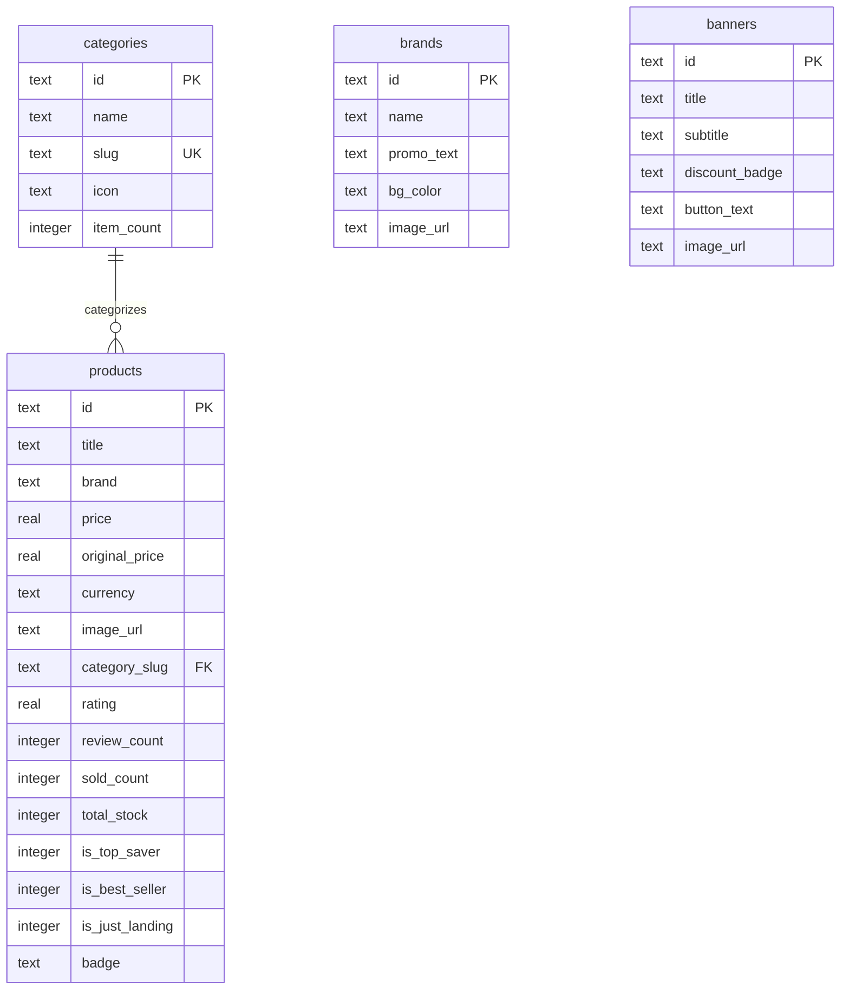

# Project Instructions & Developer Runbook

Welcome to the **Farmart Storefront** repository. This runbook documents project architecture, database management, API endpoints, development workflows, and mandatory testing gates.

---

## 1. Quick Start & Prerequisites

- **Node.js**: v20 or higher recommended.
- **Package Manager**: npm.

```bash
# 1. Install dependencies
npm install

# 2. Seed initial SQLite database (Farmart catalog, categories, brands, banners)
npm run db:seed

# 3. Start development server
npm run dev

# 4. Run automated test suites
npm test            # Unit & Integration tests (Node.js test runner)
npm run test:e2e    # End-to-end regression tests (Playwright)
npm run lint        # Code style & lint verification (ESLint 9 Flat Config)
```

The app is served at `http://localhost:3000`.

---

## 2. Architecture & Tech Stack

- **Framework**: Next.js 16 (App Router with React 19).
- **Styling**: Tailwind CSS v4, Lucide React icons, and `next-themes` (Dark/Light modes).
- **Database**: SQLite (`farmart.db`) via `better-sqlite3` operating with Write-Ahead Logging (`WAL` mode) and foreign keys enabled.
- **UI Components**: Radix UI primitives (`@radix-ui/*`) styled per `DESIGN.md` guidelines.
- **Design Tokens**: Standardized Farmart Amber theme (`#fbbf24`), warm Stone-900 typography, accessible WCAG contrast.

---

## 3. Database Schema & Visualizations

The database schema manages 4 primary entities:
- `categories`: Taxonomy with icon mapping and item counters.
- `brands`: Partner stores and promo offers.
- `products`: Catalog items with prices, badges, stock flags, and category foreign keys.
- `banners`: Homepage promotional sliders.

### Mermaid Diagram
- The interactive database ER diagram is exported to [`public/mermaid.html`](file:///Users/netparamad/Documents/GitHub/learn-ai-coding-agent-sdlc/public/mermaid.html) and [`mermaid.html`](file:///Users/netparamad/Documents/GitHub/learn-ai-coding-agent-sdlc/mermaid.html).
- Accessible in the browser at: `http://localhost:3000/mermaid.html`.



---

## 4. Backend API Endpoints

All endpoints conform to the OpenAPI 3.0.3 specification defined at [`docs/swagger.json`](file:///Users/netparamad/Documents/GitHub/learn-ai-coding-agent-sdlc/docs/swagger.json) and rendered interactively at `http://localhost:3000/docs`:

| Method | Endpoint | Description | Query Parameters |
| :--- | :--- | :--- | :--- |
| `GET` | `/api/products` | Retrieve products catalog or search matches | `search`, `category`, `brand`, `isTopSaver`, `isBestSeller`, `isJustLanding`, `limit`, `offset` |
| `GET` | `/api/products/{id}` | Retrieve single product details & related items | None (URL path param) |
| `GET` | `/api/categories` | Retrieve all product categories | None |
| `GET` | `/api/brands` | Retrieve featured store brands | None |
| `GET` | `/api/banners` | Retrieve marketing banners | None |
| `GET` | `/docs/swagger.json` | OpenAPI 3.0.3 raw specification JSON | None |

---

## 5. Search System Architecture

The search functionality spans both backend and frontend layers:
1. **Database Layer (`lib/db.ts`)**: `searchProducts({ query, categorySlug, ... })` runs parameterized `LIKE ?` filters over `title` and `brand`.
2. **API Route (`app/api/products/route.ts`)**: Validates query params and returns paginated `{ data: Product[], total: number }`.
3. **Live Dropdown (`components/sections/header.tsx`)**: Debounced (250ms) auto-complete dropdown showing instant image thumbnails, prices, and direct links.
4. **Dedicated Search Page (`app/search/page.tsx`)**: Full page search at `/search?q=...` with category filter pills, count indicators, and empty state illustrations.

---

## 6. Security Hook (PreToolUse Guardrail)

To protect the codebase and repository history from accidental destructive operations:
- **Hook Location**: [`.claude/hooks/block-dangerous-commands.sh`](file:///Users/netparamad/Documents/GitHub/learn-ai-coding-agent-sdlc/.claude/hooks/block-dangerous-commands.sh)
- **Configuration**: [`.claude/settings.json`](file:///Users/netparamad/Documents/GitHub/learn-ai-coding-agent-sdlc/.claude/settings.json)
- **Protected Commands**:
  - `rm -rf` (Recursive forced directory removal)
  - `git push --force` and `git push -f` (Force pushing to remote)
- The hook intercepts bash executions, prints a high-contrast security warning to stderr, and exits with non-zero exit code `2` to abort execution.

---

## 7. Developer Onboarding Skill (`skills/seed-data`)

New developers or automated agents can bootstrap their local environment instantly:
- **Skill Definition**: [`skills/seed-data/SKILL.md`](file:///Users/netparamad/Documents/GitHub/learn-ai-coding-agent-sdlc/skills/seed-data/SKILL.md)
- **Execution**: Run `npm run db:seed`
- Populates `farmart.db` with sample categories, store brands, marketing hero banners, and products with real pricing and stock data.

---

## 8. Mandatory Testing & Quality Gates

Before completing tasks or committing changes, all gates must pass with exit code `0`:

1. **Lint Check**:
   ```bash
   npm run lint
   ```
2. **Unit & Integration Tests**:
   ```bash
   npm test
   ```
   - Covers database queries, parameterized SQL search, empty search handling, ID lookups, API routes, swagger endpoint, and mermaid export.
3. **End-to-End Regression Tests**:
   ```bash
   npm run test:e2e
   ```
   - Validates Homepage rendering, Product Detail view, Live search form submission, Empty search state, Swagger UI (`/docs`), and Mermaid ER diagram (`/mermaid.html`).
4. **Edge Cases Catalog**:
   - Refer to [`docs/EDGE_CASES.md`](file:///Users/netparamad/Documents/GitHub/learn-ai-coding-agent-sdlc/docs/EDGE_CASES.md) for complete edge case analysis and handling guidelines.
